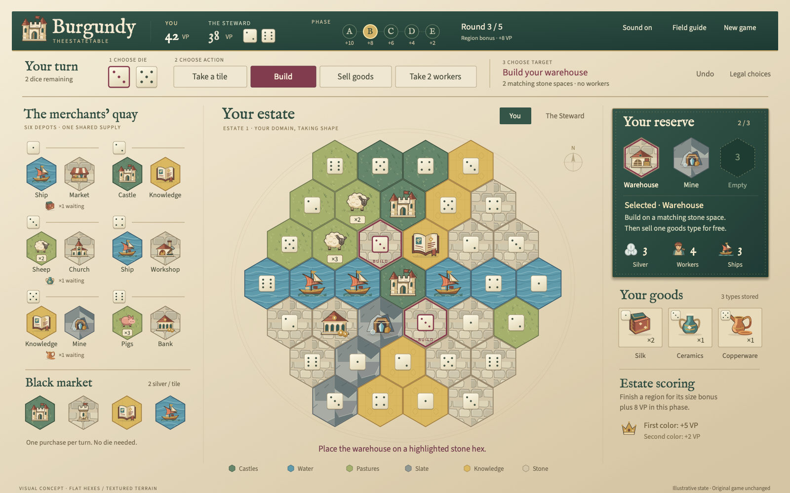

# Burgundy · The estate table

A local 2D browser game: you versus one to three computer rivals, using the original base-game rules and estates #1–9. All five phases, dice/worker actions, black-depot purchases, eight buildings, 26 knowledge tiles, bonus chains and final scoring are implemented.



*Illustrative design concept; gameplay and current interface may differ.*

## Run

Requires Node.js 22.12+.

```sh
npm install
npm run dev
```

Open the localhost address printed by Vite. No account, backend, paid AI, or API key. Fonts and graphics are local. The current table saves automatically in this browser; New game replaces it after confirmation.

## Play

**New game** offers two to four players. Standard setup uses estate #1 and the center castle. Advanced setup deals random physical boards without replacement; choose either side and any green starting space, openly in starting order or privately until all choices are complete. Existing two-player saves continue unchanged.

**New game → Rules** selects **Original 2011** or **Special Edition rule changes**. The latter changes knowledge tiles 6, 15, 26 and the score tie-break, with the exact differences shown before starting. The choice is saved for that match; older saves use Original 2011. Both options retain the existing estates #1–9 and setup choices: this is not a complete Special Edition inventory or an expansion mode. In the alternate option, owned knowledge 6 exposes a **building for 2 workers** action separate from the normal silver purchase. The Field guide and tile descriptions follow the selected rules.

1. Follow **Choose die → Choose action → Choose target**. A die is selected automatically. **Click a highlighted market tile to take it immediately**; its full worker cost is printed on the card, not abbreviated as `1w`. Changing the die updates the highlights and costs. Workers adjust the die automatically, with a brief animation showing the deduction and remaining supply. Reduced-motion mode shows the same payment without movement.
2. **Click a reserved tile, then a highlighted hex to build.** Taking and building normally use separate dice. A newly taken tile is selected for building when the remaining die can place it; no placement happens automatically. The hex must match the tile's colour, touch your estate and match the die (after worker adjustments).
3. **Click a goods stack to sell**, **Take 2 workers** to trade a die for workers, or a **black-market tile to buy** for 2 silver without a die. On phones, Sell goods opens the available stacks.
4. Ship bonuses open an illustrated harbor: choose a stocked quay and see the actual cargo. A single legal load is collected immediately; a second choice appears only when cargo competes for space. Empty or unusable harbors are summarized instead of filling the dialog with buttons. Closed goods bonuses can be reopened with **Choose goods** in the toolbar. Full reserves still require a replacement choice; cancelling spends nothing. **Undo** restores the entire last move (including automatic loading) until you end the turn or reload.
5. **End turn** stays in the top toolbar after both dice are spent and bonuses resolved. The Steward plays automatically. On phones, Market/Estate tabs switch the play surface; selecting a reserve tile brings the board into view.

Hover tiles for effects; selecting a reserve tile displays its effect. The Field guide covers actions and knowledge tiles. **Tab** and **Enter/Space** operate controls. The **All legal choices** list supports every move, and the selected tile's **Placement list** provides a keyboard alternative to the map. Inspect The Steward’s estate with the board switch. Move feedback appears briefly; Recent moves keeps the history.

Every empty board hex carries a category symbol as well as color, its matching die and a hex reference. Knowledge cards show the actual benefit; their reference number is in the tooltip. **Next region rewards** links partial regions to their outlines and explains the points earned only when every hex is filled. On desktop, the tile shop sits beside your reserve so purchases and the board remain visible together. Undo is in the header, separate from gameplay actions.

The original vector illustrations evoke medieval merchant quays, Venetian sailing vessels, guild workshops and overland trade. Silk, Spices, Ceramics, Dyes, Copperware and Wool are visual names for goods types 1–6, not new mechanics or historical claims. All rules and existing saves remain compatible.

## Checks

```sh
npm test
npm run build
npx playwright install chromium
npm run test:e2e
```

Tests cover component data, legality, resource conservation across five phases, all building/knowledge effects, scoring, deterministic save restoration, AI public-information isolation, whole-game simulations, browser controls, automatic AI turns, reload, keyboard play and responsive layouts.

## License and disclaimer

The project-authored source code and artwork are licensed under the [GNU General Public License, version 3.0](LICENSE). Third-party fonts, sounds, and dependencies retain their own licenses; see [`public/THIRD_PARTY_NOTICES.txt`](public/THIRD_PARTY_NOTICES.txt) and [`public/audio/ATTRIBUTION.txt`](public/audio/ATTRIBUTION.txt). The GPL does not grant rights to the underlying board game, its name, rules text, or other third-party trademarks and materials.

This is an unofficial fan-made implementation. It is not affiliated with, approved by, or endorsed by the creators, publishers, or rights holders of *The Castles of Burgundy*. The name is used to identify the game on which this implementation is based. No original rulebook PDF or printed board artwork is distributed in this repository. For authoritative rules and official materials, consult the rights holders' publications. This project comes without warranty; see the license.

## Scope and provenance

Two to four players (one human), all nine original estates, one heuristic computer difficulty. No expansions, online multiplayer or native application. Computer search is deterministic and bounded; it does not inspect future dice, unrevealed supply or private estate choices and is not claimed to be expert-level.

Default rules checked against the original 12-page rulebook linked in `docs/RULES.md`; supplementary reference: https://www.yucata.de/en/Rules/CastlesOfBurgundy. Uses tabletop end-game knowledge scoring, not Yucata’s continuous display adaptation. Original 2011 ties favor more empty estate spaces; the optional Special Edition rule changes favor fewer, as printed in the linked rulebook. Both then use later position on the final turn-order track. Sold goods and current/next turn order can be inspected in their disclosures. Independently authored interface, illustrations and explanatory text; original board artwork is not included in the application. Component-reference provenance is in `docs/DATA_SOURCES.md`.

Desktop and phone Chromium are exercised by automated tests. Other browsers and physical touch devices are not yet verified. Phaser currently ships as one approximately 350 kB gzip runtime bundle; Vite emits an advisory about its uncompressed size.
